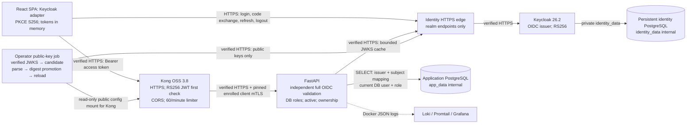
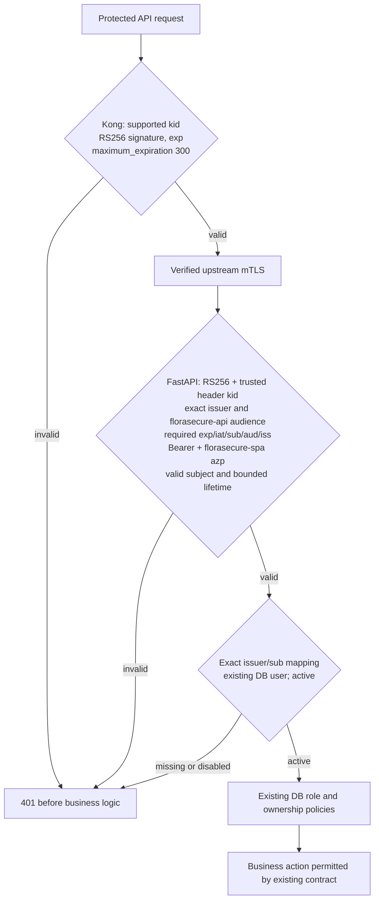

# P4 authentication candidate

P4 is an explicit release selected by `docker/p4-compose.yml`; P3 remains the
default legacy deployment for regression and release rollback. This is **not**
runtime fallback: an OIDC failure never enables local password login or HS256.
Acceptance is recorded in [the test report](../testing/p4-results.md).



Network memberships: backend `api_transport`, `app_data`, `oidc_transport`;
identity edge `identity_transport`, `oidc_transport`; key synchronizer
`oidc_transport` only. Kong remains `edge`, `api_transport`. Keycloak remains
`identity_transport`, `identity_data`. Neither data network publishes database
ports. The new network gives the resource server access to the restricted identity
edge; it does not grant access to Keycloak's private administrative interface or identity DB.
P2 certificates, separate service/client/edge authorities, SAN checking and client
enrollment remain in effect. Compose membership is not a directional firewall.

## Actual browser flow

```mermaid
sequenceDiagram
  participant B as React + keycloak-js
  participant I as Keycloak HTTPS edge
  participant G as Kong HTTPS
  participant A as FastAPI mTLS
  participant D as Application PostgreSQL
  B->>I: authorization request: code, state, nonce, S256 challenge
  I->>B: authenticate user at Keycloak
  I->>B: exact /oidc/callback?code=...&state=...
  B->>B: adapter consumes one-time state transaction
  B->>I: code + PKCE verifier (public client; no secret)
  I->>B: RS256 access/ID tokens + rotating refresh token
  B->>B: adapter validates nonce; retain tokens in memory
  B->>G: GET /api/v1/auth/me + access token
  G->>G: trusted kid + RS256 signature + exp + max lifetime
  G->>A: request over verified upstream mTLS
  A->>A: trusted JWKS signature, exact issuer/audience, Bearer, azp, time/sub
  A->>D: issuer/sub → existing user ID; active + current application role
  D->>A: application user, role and ownership data
  A->>B: application profile
  B->>I: single-flight refresh when access token approaches expiry
  B->>I: POST logout with ID-token hint and exact post-logout redirect
```

Use `keycloak-js` 26.2.4, the supported public-client adapter. The browser never
collects a local password or embeds a client secret. The adapter stores only its
short-lived callback state/nonce/PKCE transaction in supported browser storage;
access, refresh and ID tokens remain in memory. Five old `fs_*` session entries
are removed at initialization. No application role/user profile is restored from
storage. `/auth/me` supplies the current application user and role.

Initialization exposes loading/error states. A callback is processed without
starting another automatic SSO transaction that could hide a rejected state.
Before initialization or manual login, a five-second public discovery check uses
verified browser HTTPS, omits credentials, rejects redirects and requires the
exact configured issuer/authorization/JWKS endpoints. An unavailable provider
therefore produces a controlled SPA error before top-level SSO navigation.
The adapter owns state consumption, verifier handling and nonce validation;
normal unauthenticated initialization uses `check-sso`. Reload obtains new tokens
through the existing Keycloak SSO cookie and a fresh code transaction. Tokens are
not recovered from localStorage. Third-party-cookie restrictions can cause a
top-level SSO redirect. There is no BFF or server-managed HttpOnly application
session. XSS can still read in-memory tokens; CSP/XSS remediation is outside P4.

Concurrent API requests share a single refresh promise. Failed refresh clears
tokens and application authentication. API 401 also clears the session; there is
no automatic retry with a legacy token. Expired/failed/cancelled sign-in is shown
without a local-login fallback. Reload sign-in to retry initialization after an
IdP outage. Logout captures the adapter's ID-token hint before memory cleanup,
uses POST to avoid putting a full ID token in access-log URLs, and returns to the
configured `/login`. Closing a tab alone does not necessarily end Keycloak SSO.

## Token validation and revocation



Access tokens have payload `typ=Bearer`, `azp=florasecure-spa`, audience containing
`florasecure-api`, header `alg=RS256`, `typ=JWT`, and a bounded `kid`. Require integer
`iat`/`exp`, lifetime at most 300 seconds and no future `iat` beyond five seconds.
JOSE verifies expiration and applicable `nbf`; subjects must be nonempty bounded
strings without control characters. ID and refresh tokens fail access semantics.
Untrusted issuer/key URLs from token claims are never fetched.

Kong's native plugin is **not** an OIDC validator. It may pass a correctly signed
wrong-issuer/audience/type token to FastAPI, which independently rejects it. Keycloak omits optional `nbf`, whereas Kong requires every claim listed in
`claims_to_verify`; the gateway therefore verifies mandatory `exp` only. FastAPI
rejects future `nbf` whenever present, including a trusted signed token forwarded
by Kong. No token contents are altered to accommodate gateway checks. Only
Authorization headers supply gateway JWTs; URL parameters and JWT cookies are
disabled. Client identity/role headers and Keycloak roles never override DB RBAC.
The consumer represents signing keys, not an application user.

JWKS is fetched over verified HTTPS from only the configured realm. No redirects
or environment proxy trust; five-second timeout, 64-KiB response bound, at most 16
keys, unique bounded kids, public-only RSA keys of at least 2048 bits and exponent
65537. Cache TTL defaults to 60 seconds, unknown-key refresh interval five seconds.
An expired cache is never used after failed refresh. Warm known keys remain valid
only within TTL during an outage. Tokens are bounded to 16 KiB. Configurable cache
limits are validated at startup.

Logout/session revocation prevents future refresh, but a previously issued access
token can remain valid until its 300-second expiration while signing trust remains.
Key retirement can additionally take the backend cache TTL unless the backend is
restarted. DB `is_active=false` is checked per request and denies immediately.
Changing application roles takes effect per request. No introspection or JWT
revocation list is claimed. See [controlled key rotation](../deployment/p4-key-rotation.md).

## Gateway route security matrix

| Route | Gateway policy | Application policy |
|---|---|---|
| GET/HEAD `/api/v1/products[/<id>][/]` | Public, limited | Existing public product reads; unsupported methods remain unsupported |
| GET/HEAD `/health`, `/health/ready` | Public, limited | P2 health/readiness; no admin access |
| POST `/api/v1/webhooks/receive` | Public JWT exemption, limited | Existing HMAC and timestamp checks |
| `/api/v1/webhooks/test-signature` | Explicit 404 | Existing DEBUG=false helper disabled |
| `/api/v1/auth/login`, `register`, `refresh`, `logout` | 410 | Independently disabled in OIDC release |
| Remaining `/api/v1` routes | Native JWT, limited after validation | Full OIDC, mapping, current DB RBAC/ownership |
| Exact allowed-origin CORS preflight | CORS response before JWT | No business action |
| Docs/admin/other unmatched paths | No gateway route | No administrative exposure |
| OIDC realm/discovery/JWKS/callback | Dedicated identity edge / SPA | Not routed through Kong; admin/master denied at public identity edge |

Kong 3.8's router anchors `~/...$` route regexes at the start of the path. Public
regex routes have explicit methods and higher priority; product mutations retain
protected JWT handling. The JWT plugin executes before the existing limiter, so
JWT failures do not consume its counters. Public and valid authenticated requests
still share the 60/minute local policy per caller IP (`limit_by=ip`). Signing-key
consumers never become a shared quota for every application user. Additional pre-authentication abuse controls
are outside P4.
