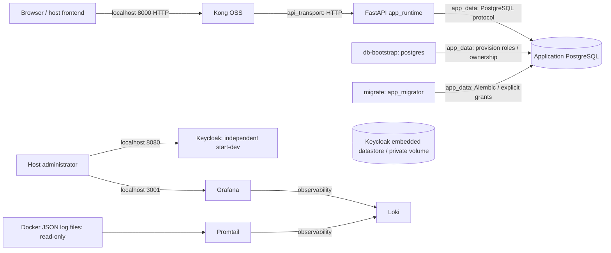

# P1 deployment and isolation

P1 builds on approved P0 commit `0bc7a404e4a1d5a4d74a82293dbe9dc857a7a030`.
It changes deployment credentials, PostgreSQL permissions, networks and readiness.
Application authentication, local JWT issuance, algorithms, RBAC/ownership rules,
Product/Order/User policy and the initial migration are unchanged.

## Architecture



Network membership gives container reachability boundaries. It does not provide
encryption, mutual authentication, or directional firewall rules. HTTP and ordinary
PostgreSQL transport remain in use. The dedicated API network is the future P2
Kong-to-FastAPI HTTPS/mTLS path; no P2 transport configuration is introduced here.

| Container | edge | api_transport | app_data | identity_transport | observability |
|---|:---:|:---:|:---:|:---:|:---:|
| kong | yes | yes | — | — | — |
| backend | — | yes | yes | — | — |
| postgres | — | — | yes | — | — |
| db-bootstrap (one-shot) | — | — | yes | — | — |
| migrate (one-shot) | — | — | yes | — | — |
| keycloak | — | — | — | yes | — |
| loki | — | — | — | — | yes |
| promtail | — | — | — | — | yes |
| grafana | — | — | — | — | yes |

`app_data` and `observability` are internal networks. `edge`, `api_transport` and
`identity_transport` are standard bridge networks. The host-run frontend is not a
Compose container. No service uses the implicit default network. No database or
backend host ports are published. Gateway, identity and Grafana retain loopback-only
host ports; their management access still requires host/SSH access controls.

**Approved egress decision:** the user explicitly approved a standard API bridge
after an isolated runtime probe showed an all-internal backend cannot resolve public
DNS. This preserves the existing SSRF validator's DNS operation. It permits broader
outbound egress from FastAPI/Kong; this deployment does not claim destination-restricted
egress. The data network remains internal and unrelated namespaces are tested against
both the PostgreSQL DNS name and its real IP. Changing this later requires an agreed
DNS/egress design, not weakening the database boundary.

Keycloak retains its existing embedded datastore in `keycloak_data`. No separate
identity database container or empty identity-data network is introduced: the current
data boundary is that private volume. A future external identity DB should get its
own internal identity data network, with Keycloak and that DB as the only members.

## Role and secret boundaries

| Role | Who receives credentials | Privileges |
|---|---|---|
| postgres | PostgreSQL and one-shot db-bootstrap | Cluster superuser; bootstrap trusted UUID extension, login roles and reviewed ownership transfers |
| app_migrator | One-shot migrate (bootstrap also provisions its password) | Non-superuser; CONNECT, public-schema USAGE/CREATE; owns known application objects; Alembic DDL and explicit grants; no CREATEDB, CREATEROLE, replication, BYPASSRLS or inherited memberships |
| app_runtime | FastAPI (bootstrap also provisions its password) | CONNECT, public-schema USAGE; SELECT/INSERT/UPDATE on users/products/orders/refresh_tokens; SELECT/INSERT on order_items; SELECT on categories/alembic_version; trigger function execution |

`app_runtime` has no database CREATE/TEMP, schema CREATE, object ownership, DELETE,
TRUNCATE, audit-log privileges, sequence privileges, Alembic-version writes, role
membership, superuser or role-administration grants. Required DML is tested through
all P0 application cases plus direct insert/update/trigger/FK probes. `audit_logs`
is not written by current application code; granting it privileges is deferred until
an audit implementation is reviewed. New tables do not receive blanket default DML
grants: migration changes require an explicit runtime-grant review.

The bootstrap script reassigns only the known application tables, enum types and
timestamp trigger function, preserving rows, UUIDs and relationships. It never runs
`REASSIGN OWNED BY postgres`, which could transfer unrelated objects. Unexpected
table ownership or role memberships stops bootstrap for manual review. The original
initial migration is unchanged. `alembic/env.py` escapes ConfigParser `%` characters
so file passwords containing reserved URL characters can be safely encoded.

Compose file secrets are mounted only into consumers. No passwords/JWT/webhook keys
are literal Compose environment values or Dockerfile build arguments. API credentials
are read from files and passed to the application process internally. Migration imports
require Settings, so the job generates throwaway in-process JWT/webhook values; it
never receives the real application signing keys. Grafana uses its native secret-file
option; Keycloak's small wrapper loads its bootstrap password from a mounted file.

Compose secrets on a single node are host-backed files, not an encrypted vault.
Restrict host directory ACLs (Windows) or owner/mode (Linux), back up secrets securely,
and treat Docker/host administration as privileged. Process environment and mounted
files are visible to a sufficiently privileged administrator. Changing a file does not
rotate an already running application's credentials; coordinate bootstrap/restart and
database rotation during maintenance.

## New deployment

Requirements: Docker Compose 2.24.4+ (test overlay uses `!reset`), a rootful Linux Docker
Engine or Docker Desktop Linux containers, Python 3.9+ for helper scripts. From repo root:

```powershell
Copy-Item docker/.env.example docker/.env
python docker/generate_secrets.py --new-deployment
docker compose --env-file docker/.env -f docker/docker-compose.yml up --build -d --wait
```

The helper refuses to overwrite existing secrets. All secret files are ignored by Git.
The production startup graph is PostgreSQL health -> bootstrap success -> migration
success -> backend readiness -> Kong. Loki readiness gates Grafana and Promtail;
Keycloak health is checked on its private management port. Promtail readiness and
actual ingestion are checked by P1 tests; Compose only confirms its process is running.

`/health` retains its P0 response and reports API process liveness. `/health/ready`
returns 200 only when a database query succeeds and Alembic revision(s) match the
image's head(s); it returns a generic 503 on dependency/schema failures without SQL
or credential details. Connection/pool waits are bounded at three seconds, and the
readiness query has a two-second statement timeout. Because a DNS lookup can outlast
database connection timeouts, readiness uses one reusable worker and returns 503 after
a 2.5-second wait; repeated probes cannot create an unbounded thread/job backlog.
Compose health/dependency ordering
is startup coordination: it does not automatically remove Kong routes, restart unhealthy
containers, or provide high availability during later outages.

FastAPI DEBUG remains false in this deployment: Swagger is disabled. Local development
outside Compose can still use the existing backend environment settings. The frontend
continues to use the loopback Kong port.

## Existing-data adoption and rollback

Do not run the new-deployment secret generator against an established deployment or
use `down --volumes`. Work during a maintenance window with the existing Compose
project name so named volumes are retained.

1. Take and verify an isolated restore of the application DB, and securely back up
   the existing PostgreSQL password, JWT signing key, webhook secret, identity/Grafana
   credentials, environment/configuration and volume/project identity.
2. Create the secret directory with restricted access. Preserve the existing values in
   `postgres_password`, `jwt_secret`, `webhook_secret`, `keycloak_admin_password` and
   `grafana_admin_password`. Generate separate random `migration_password` and
   `runtime_password`. Do not rotate signing keys incidentally or paste secrets into
   shell history. An existing PostgreSQL volume does not change its password merely
   because POSTGRES_PASSWORD_FILE changes.
3. Retain APP_DB_NAME and any intentional non-default application settings. Only
   variables explicitly referenced by Compose are forwarded; move other customized
   non-secret backend settings into a reviewed Compose environment override before
   restoring traffic. The old backend `.env` is no longer loaded by this deployment. Stop
   request traffic/backend. Build the new image; start PostgreSQL and run
   `docker compose ... run --rm db-bootstrap`, then
   `docker compose ... run --rm --no-deps migrate`. Stop on errors.
4. Start/recreate the P1 services using the same project and volumes. Verify readiness,
   role boundaries and representative logins/orders before restoring traffic.

The P1 adoption test builds a separate P0 schema as postgres, inserts linked synthetic
users/products/orders/items, then bootstraps/migrates twice and compares every seeded
row and ID. Actual production data is never touched by the test runner.

Rollback: stop traffic and P1 jobs; restore the previous Compose/application revision
and its securely saved environment values using the same data volumes. PostgreSQL's
existing superuser path can operate on the transferred objects. P1 adds no schema
revision and changes no application rows, so an automatic downgrade/drop is neither
needed nor appropriate. The added roles/ownership hardening can remain while the old
superuser deployment is temporarily restored. Only restore the verified DB backup if
the data actually requires recovery; role cleanup/reownership needs a separate review.
Rolling back reintroduces the old broad network and credential privileges.

## Monitoring boundary

Promtail no longer mounts `/var/run/docker.sock`. A read-only socket bind would still
allow Docker API operations, so network isolation alone would be misleading. Instead,
Promtail reads the daemon's JSON log directory read-only, labels records with Compose
service/project, drops records outside this project, and sends logs on observability.
Docker log rotation is set to 10 MB × 3 per service. Positions use a separate volume.

The daemon's actual log directory must match DOCKER_LOG_ROOT. This was exercised with
Docker Desktop Linux containers. Rootless/custom daemon paths require configuration.
The mount can expose host container logs/metadata to Promtail even though ingestion
filters by project; it is not a confidentiality boundary against a compromised reader.
Docker cautions against external interactions with its JSON log files, so this mount
is strictly read-only and is a transitional collector arrangement. It removes Docker
API control without adding another service. An agent/collector redesign, including
the existing Promtail lifecycle issue, remains outside P1.

References: [PostgreSQL privileges](https://www.postgresql.org/docs/16/ddl-priv.html),
[Keycloak health checks](https://www.keycloak.org/observability/health),
[Docker JSON logging behavior and limitations](https://docs.docker.com/engine/logging/drivers/json-file/).
