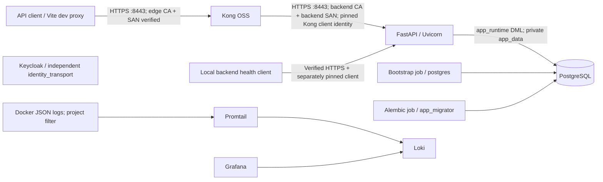

# P2 deployment: verified HTTPS and mutual TLS

Based on approved P1 `d3f537f1dde7550cc946b1d13f2eba3d634d1c9e` on
`migration/cloud-api-security`. Docker Compose, Kong OSS 3.8, Uvicorn 0.29,
single node. P2 changes transport and deployment tooling only. Local HS256 JWTs,
PostgreSQL RBAC/is_active authority, application UUIDs, Product/Order/User policy,
webhook HMAC, SSRF validator and Kong 60/minute rate limit remain unchanged.
Keycloak is still independent; no OIDC, Kong JWT plugin or P3/P4 work is included.



## Boundaries and memberships (unchanged from P1)

| Service | edge | api_transport | app_data | identity_transport | observability |
|---|---|---|---|---|---|
| kong | yes | yes | — | — | — |
| backend | — | yes | yes | — | — |
| postgres | — | — | yes | — | — |
| db-bootstrap | — | — | yes | — | — |
| migrate | — | — | yes | — | — |
| keycloak | — | — | — | yes | — |
| loki/promtail/grafana | — | — | — | — | yes |

`app_data` and `observability` are internal networks. The approved standard API
bridge preserves public DNS/egress required by the current SSRF URL validator.
Membership isolates reachability; it is neither encryption nor a directional
firewall. Kong/identity/monitoring do not share the application DB network.
PostgreSQL and FastAPI have no published host ports. Kong publishes only
`127.0.0.1:8443 -> 8443`, with HTTP :8000 absent; FastAPI listens only on :8443.
Keycloak/Grafana loopback UI ports and monitoring filesystem collector are retained.
Vite's local development UI still uses loopback HTTP; its API proxy uses verified HTTPS.

## Trust model and supported configuration

Three independent RSA/SHA256 development issuers (CA key 3072 bits, pathLen=0,
CA keyCertSign/cRLSign) separate upstream server, client enrollment and external edge
trust. Leaf keys are 2048 bits, CA=false, digitalSignature/keyEncipherment, one EKU.
CA validity is one year; leaves last at most 30 days and never outlive their issuer.
Random serials and a five-minute notBefore allowance are used. Synchronize host clocks.

| Certificate | SAN | EKU | Issuer | Verifier |
|---|---|---|---|---|
| backend/server.pem | DNS backend | serverAuth | server CA | Kong; local health probe |
| kong/client.pem | DNS kong.internal | clientAuth | client CA | FastAPI: enrolled leaf pin + issuer check |
| backend/health.pem | DNS backend-health.internal | clientAuth | client CA | FastAPI: separate enrolled health leaf |
| kong/edge.pem | DNS localhost, kong; IP 127.0.0.1 | serverAuth | edge CA | Browser/CLI/Node with explicitly configured edge trust |

Kong uses the built-in OSS `client_ssl` options, a runtime trusted server CA file,
global `proxy_ssl_verify on` and Service `tls_verify: true`. Its generated Nginx
config sets SNI and `proxy_ssl_name $upstream_host`. The service URL is
`https://backend:8443`; route `preserve_host: false` keeps the internal identity
independent of public Host headers. The negative SAN/issuer/purpose tests exercise
actual Kong, rather than relying on a generic HTTPS client's verifier.

Uvicorn's native `CERT_REQUIRED` verifies clients but does not match a client SAN
to the gateway identity. P2 uses its supported programmatic Config/SSLContext path:
`CERT_REQUIRED`, TLS >=1.2, and OpenSSL `VERIFY_X509_PARTIAL_CHAIN`, with **only
enrolled client leaves** in `client-pins.pem`. This directly authenticates the
enrolled certificate/key rather than trusting every certificate an issuer could
sign. During startup, `deployment.tls` checks the leaf-only store, exact allowed
SANs and issuer signatures against the separately supplied client issuer CA bundle.
At handshake OpenSSL enforces key possession, validity and clientAuth purpose.
No HTTP header, middleware or post-handshake 401/403 simulates client-certificate auth.
Other leaves from the same trusted issuer are rejected unless explicitly enrolled.
Issuer CA roots must **never** be placed in the pin store. Multiple old/new leaves
per identity are allowed during a controlled overlap. The health identity is local
deployment tooling, with the same API permissions as a TLS client; JWT/RBAC still
apply. Its key is available only to backend, not Kong or monitoring services.

Runtime read-only directory mounts expose only:

- Backend: its server key/cert, its health key/cert, server CA, client issuer bundle
  and public client pins. No gateway client key or CA signing key.
- Kong: client key/cert, edge key/cert and server CA. No backend/health private keys
  or CA signing keys.
- `offline/`: CA signing keys, **no service mount**. `trust/`: public CA exports.

Private file mode is 0600, directories 0700 on Unix. Root-run issuance sets the Kong
directory/key owner to deployment UID 1000. Non-root Linux issuance requires an operator
to make those runtime files readable by UID 1000 without making private keys public.
Windows bind mounts require restricted host ACLs; chmod is not a Windows ACL.
The 2026-10-25 image update explicitly runs Kong 3.9.3 as UID/GID 1000 because
its image default changed to 1001. Its writable prefix is `/run/kong` on tmpfs;
packaged `/usr/local/kong/lib` remains visible. Key permissions are unchanged.
See the [current image upgrade/rollback guide](final-image-upgrade-rollback.md).
Compose bind mounts are not an encrypted secret manager. Protect host/backups and
offline signing keys; the Docker daemon/host administrator remains trusted.
Neither backend nor Kong receives PKI through image COPY, environment key contents
or committed YAML. `SSLKEYLOGFILE` is cleared in backend/probe/test clients.

Supported-source references: [Kong 3.8 service schema](https://github.com/Kong/kong/blob/3.8.0/kong/db/schema/entities/services.lua),
[Kong 3.8 Nginx TLS template](https://github.com/Kong/kong/blob/3.8.0/kong/templates/nginx_kong.lua),
[Uvicorn 0.29 SSL context](https://github.com/encode/uvicorn/blob/0.29.0/uvicorn/config.py),
[Python 3.11 SSL partial chain](https://docs.python.org/3.11/library/ssl.html#ssl.VERIFY_X509_PARTIAL_CHAIN).

## Issuance and clean local deployment

From repository root, Python and Docker Desktop/Linux containers are required:

```powershell
python -m pip install -r docker/pki-requirements.txt
python docker/pki.py --development-only
# New deployments only. Existing deployments must preserve all P1 secrets/data.
python docker/generate_secrets.py --new-deployment
Copy-Item docker/.env.example docker/.env
docker compose --env-file docker/.env -f docker/docker-compose.yml config --quiet
docker compose --env-file docker/.env -f docker/docker-compose.yml up --build -d --wait
curl.exe --cacert docker/certs/trust/edge-ca.pem https://localhost:8443/health
$env:NODE_EXTRA_CA_CERTS = (Resolve-Path docker/certs/trust/edge-ca.pem).Path
Set-Location frontend
npm ci
npm run dev
```

Generation refuses to overwrite an existing directory. Never generate fresh P1 secrets
over an existing DB/JWT/HMAC deployment. `PKI_DIR` defaults to `docker/certs` when
resolved by Compose. The generator's own default is the same absolute directory.
For API calls the caller needs only the public edge CA. Backend is inaccessible to
ordinary API clients and requires an enrolled mTLS client even from its own network.
Configure development browser trust by checking/exporting **only edge-ca.pem** and
importing that public CA into the development user's/browser's trust store; never
import a private key, server CA or client CA as general browser trust. The tool does
not install host trust automatically. CLI CA files and Node extra trust avoid a
machine-wide trust change. Do not bypass errors in curl/browser/Node/Vite.

`docker/certs` is development-only and ignored by Git. Keep production issuer keys
outside this tree and outside service hosts. For production, provision an ACME/public
CA edge certificate with the real public DNS SAN (including full intermediate chain),
normally publish 443, and maintain a separate internal managed/private CA for backend
certificates. Enroll production gateway/health leaves after verifying their intended
SAN, clientAuth EKU, validity, issuing CA and fingerprints; provision `client-issuers.pem`
and `client-pins.pem` without using the development signing keys. The direct-issuer
enrollment check currently supports leaves directly issued by the supplied CA; with
an intermediate issuer, supply that issuing CA certificate and enforce its trust
externally in provisioning. Production automation, renewal alerts, revocation services
and hardened host provisioning remain operator responsibilities.

## Renewal, CA rotation and recovery

Issue replacements into a **new directory**, inspect fingerprints/SAN/EKU/expiry and
back up the matching existing runtime cert/key/trust sets securely before activation:

```powershell
# Leaf renewal under existing DEV issuers, never overwrites the active directory.
python docker/pki.py --development-only --directory docker/certs-next --ca-directory docker/certs/offline
# For CA rotation instead, omit --ca-directory; use a fresh unused output directory.
```

An offline signer may be elsewhere; `--ca-directory` accepts that path. Renewal reuses
the issuer but creates new keys and pins, so it still requires enrollment overlap.
The automated `tests/p2/host_checks.py` provides an executable full CA/leaf/edge
rotation and rollback rehearsal in an isolated deployment. Apply this exact order:

1. Concatenate old+new **server CA certificates** into both peers' `server-ca.pem`.
   Concatenate old+new **client issuer CA certificates** in backend/client-issuers.pem,
   and old+new **client leaf certificates** in backend/client-pins.pem. Do not put
   signing keys or CA certificates in the leaf pin store. Restart backend and Kong;
   verify old certificates still work.
2. Replace Kong client.pem/client.key as a matching pair, retaining overlapping server
   trust. Restart Kong; verify new Kong client with old backend server gives HTTP 200.
3. Replace backend server.pem/server.key and health.pem/health.key as matching pairs.
   Restart backend; verify health/readiness and gateway business requests.
4. Once every peer uses the new generation, replace the overlapping server trust,
   client issuer bundle and pin store with new-only files. Restart both peers; prove
   new peers work and the previously enrolled old client fails TLS.
5. Rotate edge cert/key separately. Distribute old+new edge trust to development
   clients before replacing the gateway edge pair and restarting Kong. Verify with
   new trust, then retire old client trust and verify old-only trust fails. With a
   public production CA, manage renewals/intermediates using that CA's tooling.

Do not modify cert/key pairs concurrently with automatic restart; stage the full
directory and recreate with a selected `PKI_DIR`, or stop the affected service, replace
its runtime files, then restart. Existing bind directory mounts see replacement files;
SSLContexts retain loaded certificates until process restart. Compose secrets/file
mount replacement behavior must be considered if deployment tooling is changed.
Expect a brief single-node outage while each listener restarts. Data volumes, migration
jobs, DB passwords and JWT/HMAC secrets are not part of certificate rotation.

Recovery: restore the **matching** backed-up server/client/health/edge key+cert pairs
and their server CA, client issuer bundle and pin store; restart backend first, then
Kong, and verify strict HTTPS health/readiness before traffic. Reintroduce old trust
only if it is still valid and uncompromised. For a compromised key, issue a new key
and remove its old pin immediately; for a compromised issuer, retire its trust as
well. There is no live CRL/OCSP check in this local PKI; short validity and enrollment
removal are the current revocation controls. Never recover by enabling HTTP or
disabling verification. Rolling back the source to P1 would reintroduce HTTP and
requires a separately reviewed security downgrade, not routine P2 recovery.

## Validation and historical fixtures

Run `python tests/p2/run.py` from repo root after installing PKI requirements and
`npm ci` in frontend. It builds the actual main Compose plus test overlays, creates a
random project/volumes/passwords/PKI, publishes an ephemeral loopback HTTPS port and
always tears down only that project. The privileged test service has app_data and
api_transport plus test PKI to seed/clean and probe; it is not a production service.
No existing containers/volumes are attached or changed. Artifacts are ignored under
tests/p2/artifacts. Test execution includes complete P0/P1 assertions, TLS1.2/1.3
negative socket tests, actual Kong verifier failures, HTTPS business checks, actual
Vite proxy verification, CA/leaf rotation, log/layer secret scans and recovery.

P1 runner now provisions PKI and runs its same checks over P2 transport. Standalone
P0 remains a historical HTTP baseline in its disposable test-only Compose, using
`tests/p0/kong.baseline.yml`; those configurations are not alternatives to the secure
main deployment. Legacy Nginx/compose-mtls.reference examples are labelled historical
and incompatible with the P1/P2 DB/network model. Earlier P0/P1 results and deployment
documents are historical records; this document supersedes their HTTP startup URLs.
