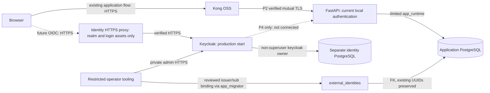

# P3 identity preparation

P3 builds on approved P2 `16703e01285938c6b8d002b672f2124e8ab24ac1`.
Keycloak is an independently operated future issuer. FastAPI continues to issue and
validate its existing local JWTs, rotate its existing refresh tokens, and enforce
PostgreSQL RBAC, `is_active`, and ownership. No Keycloak request-path validation,
Kong JWT plugin, claim-derived role assignment, or P4 cutover is enabled.



`app_data` and `identity_data` are distinct internal Compose networks. No database
port, Keycloak service port, management port or admin endpoint is published. Only
`identity-edge` publishes loopback HTTPS 9443. Its default route returns 404; it
forwards `/realms/florasecure/` and `/resources/` and verifies the Keycloak upstream
certificate for SAN `keycloak`. P1 service memberships and the P2 API transport
remain intact, with only Keycloak gaining its own identity-data network. The
identity bootstrap job has only that network and exits before Keycloak starts.

## Realm/client configuration

Source: `docker/keycloak/florasecure-realm.json`. Realm imports on first start;
Keycloak deliberately skips import of an existing realm. Changing the JSON does
not silently overwrite a live realm: back up, review an admin API/export update,
apply it through private administration and rerun tests. Never delete identity data
volumes to apply configuration to a populated deployment.

| Setting | P3 value |
|---|---|
| Realm | florasecure; SSL required for all requests |
| SPA | florasecure-spa, public client, no client secret |
| Flow | authorization code; mandatory PKCE S256 |
| Disabled SPA flows | implicit, hybrid, password grant, service accounts |
| Exact redirect | https://localhost:5173/oidc/callback |
| Exact web origin | https://localhost:5173 |
| Default client scopes | basic (required subject claim), profile, email; no application-role mapping |
| Access signing / audience | RS256 / florasecure-api |
| ID-token audience | florasecure-spa |
| Access lifespan | 300 seconds |
| SSO idle / maximum | 1800 / 28800 seconds |
| Refresh policy | rotate/revoke, zero reuse |
| Self-registration / password reset | disabled until an operational policy is reviewed |
| Email login / duplicate email | disabled / disallowed within Keycloak |
| Brute-force protection | enabled |
| Seeded users/passwords | none; tests create disposable users with runtime-generated passwords |

The localhost SPA callback is an explicit preparation/test URL, not the existing
HTTP Vite authentication UI. Configure reviewed deployment-specific HTTPS redirect
and origin values before first production realm import. Wildcards are prohibited.
`frontend/src/identity/oidcPreparation.js` is inactive and is not imported by the
current UI. It tests client-layer state/nonce checks; it does not decode or verify
JWT signatures or exchange tokens. P4 must provide verified claims and implement
transaction storage, one-time consumption, replay handling and actual UI wiring.

## Required runtime configuration

Generate new secret files with `python docker/generate_secrets.py --new-deployment`.
Existing deployments must add the **two new files** `identity_admin_password` and
`identity_db_password` with independent random secrets, without overwriting any
P1 secret. Store files securely, mount only into their named services, and ensure
container readers have access. Compose file-backed secrets are mounts, not a
vault. Do not put secrets in environment templates, image builds or realm JSON.

Set `IDENTITY_HOSTNAME` to the stable HTTPS origin, including any nondefault port.
Issuer is exactly `<origin>/realms/florasecure`; discovery and token validation must
use that exact issuer. Set `IDENTITY_TLS_DIR` to a directory with:

- `keycloak/server.pem`, `keycloak/server.key`, `keycloak/identity-ca.pem`: chain/key for SAN `keycloak`.
- `edge/server.pem`, `edge/server.key`: chain/key for the browser-facing hostname.
- `edge/identity-ca.pem`: trust anchors for Keycloak upstream verification.

Private keys remain outside Git, readable only by the required processes. Supply
real PKI enrollment/renewal in production; the test PKI is disposable development
PKI and never changes host trust. Missing configuration fails closed. Keep hostname,
ports, certificate SANs and exact SPA URLs consistent. No `verify=False`, `-k`,
insecure proxy TLS or disabled certificate/signature verification is supported.

From repository root, with the existing P1/P2 secrets and PKI:

```sh
docker compose --env-file docker/.env -f docker/docker-compose.yml up -d --wait backend kong keycloak identity-edge
```

Keycloak readiness uses verified internal management HTTPS 9000; it is not published or
forwarded. The JDK probe trusts only the supplied identity CA and keeps hostname verification. User and admin requests use HTTPS only. Restrict host/container admin
access and replace the temporary bootstrap admin with reviewed named operators.
Default deployment is one instance, not a HA cluster. The identity DB owner can
migrate its own schema but cannot create databases/roles or become superuser.
Separate infrastructure credentials are never mounted into the application.

## Identity mapping schema and operator procedure

`0002_external_identities` is additive and depends on `0001_initial_schema`.

| Column/constraint | Meaning |
|---|---|
| issuer varchar(512), subject varchar(255) | composite primary key, exact trusted issuer and opaque Keycloak sub |
| user_id UUID NOT NULL | FK to existing users.id, ON DELETE RESTRICT |
| UNIQUE(issuer, user_id) | one reviewed subject per application user per issuer |
| reviewed_by varchar(255), review_reference varchar(512) | required nonempty operator/review record |
| created_at timestamptz | database timestamp |
| CHECK | HTTPS issuer and nonempty subject/review metadata |

The migration does not update or recreate any application user/order/product.
No email column or email-driven lookup exists. Runtime has no permission to read or
write this inactive table. `deployment.identity_mapping` runs only as an explicit
offline operator command with migration credentials. Its exact trusted-issuer
configuration must come from the operator, never a submitted token. SQL uniqueness
and FK constraints reject duplicate/conflicting mappings and unknown users.

1. Back up application and identity databases separately; securely retain exports.
2. Review authoritative application UUID, exact trusted issuer and Keycloak sub.
   An email match is insufficient evidence. Record independent identity proof,
   reviewer and change/ticket reference. Check existing bindings and account status.
3. Run the existing dedicated migration job (`deployment.migrate`) to head. It
   retains all prior runtime grants and grants nothing on external_identities.
4. In a controlled private operator process, provide the migration password-file
   configuration and `TRUSTED_IDENTITY_ISSUER`; from `backend/` execute:

```sh
python -m deployment.identity_mapping --issuer https://identity.example.com/realms/florasecure --subject <verified-sub> --user-id <existing-uuid> --reviewed-by <operator> --review-reference <review-ticket>
```

No upsert, automatic replacement, user creation, role change or email linking is
performed. A uniqueness failure requires investigation; do not delete the existing
binding to make an unreviewed request pass. Database owners remain privileged and
can bypass operator tooling; restrict/audit those credentials. Preserve review
records outside the database as well.

## Rollback

P3 auth infrastructure is independent: stop `identity-edge` and Keycloak without
changing current app auth or P2 TLS. Preserve the identity DB volume and backups.
To roll back application schema, stop operator writes, export reviewed mappings,
then run `alembic downgrade 0001_initial_schema` with migration credentials.
This removes **only external_identities**, losing its rows; application UUIDs,
users, orders and relationships remain. Restore P2 code before bringing readiness
checks back up because readiness compares the database with the checkout's head.
Re-upgrade restores an empty mapping table; restoring bindings requires review.
Do not downgrade to base or remove application/identity volumes during rollback.
P3 does not authorize plaintext rollback of P2.

## Validation

```sh
node tests/p3/test_client.mjs
python tests/p3/run.py
```

The runner uses a random Compose project, separate application/identity volumes,
new runtime secrets and PKI, and cleanup in `finally`. It executes full P0/P1/P2
regressions plus actual HTTPS discovery/JWKS, real login/authorization-code/PKCE,
negative flows/redirects, signature-verified token issuer/audience/nonce, refresh
rotation, mapping constraints, populated-data migration/rollback, identity network
isolation and identity DB/Keycloak restart persistence. Hostnames in evidence are
isolated service names, not public preview URLs. Public signing keys/discovery are
safe to retain; tokens, passwords and private keys are never retained as evidence.
`P3_BUILD_OVERLAY` optionally supplies an environment-specific build overlay for
proxy/CA configuration; it must preserve TLS, artifact and package verification.
See `docs/testing/p3-results.md` for executed outcomes and limitations.

For a file-secret-based Compose migration container, an explicit downgrade command
must initialize the migration connection before invoking Alembic (raw `alembic`
alone does not read deployment password files):

```sh
python -c "from deployment.common import configure_application; configure_application(migration=True); from alembic import command; from alembic.config import Config; command.downgrade(Config('alembic.ini'), '0001_initial_schema')"
```

Run it only with the migration job's private network, working directory and secret
mounts; never give the API or public identity proxy migration credentials.
