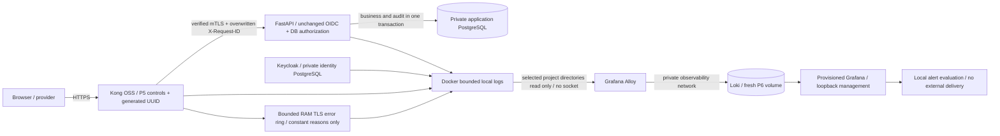

# P6 observability candidate

Acceptance and executed evidence: [results](../testing/p6-results.md). This is a Compose candidate, not a production rollout.

Kong owns the request-ID boundary: pre-function replaces caller IDs with random v4 UUIDs before P5 quotas/JWT. Post-function restores that same response header. FastAPI accepts only a canonical v4 UUID over the enrolled mTLS connection; absent/invalid IDs receive fresh UUIDs. Local probes can generate independent IDs. IDs are tracing aids, not credentials. Requests without a routed plugin execution may lack an ID; test coverage must distinguish them.

API/Kong remain outside the observability network. Only a disposable test client crosses both for assertions. Alloy cannot reach application or identity databases. No Docker socket is mounted. Deployment must generate a collector mount manifest from reviewed container IDs, limited to backend/Kong/Keycloak directories. Container recreation requires updating that manifest. Mounts include Docker container metadata, a residual read-access risk; a future dedicated log-file export can narrow that further. Never mount all Docker directories in production by default.

General API telemetry deliberately excludes IPs, actor IDs, subjects, email, query strings, headers, raw bodies and exception messages. Request IDs and normalized application routes stay inside JSON, not labels. Labels are project/service; filename is dropped. Gateway uses a fixed `gateway` route label rather than recording arbitrary paths. Precise per-route gateway rejection dashboards are therefore unavailable.

Raw Uvicorn access logs are disabled; Kong access format contains only status/timing/generated response ID. Proxy error logging is disabled in the P6 overlay to avoid URL/authorization-code context; coarse upstream status signals remain. The bounded OSS log-phase relay emits four constant upstream TLS verification reasons without raw request/error context; these worker events remain unattributed. Actual P2 rejection and Loki-ingestion evidence verifies the four reasons. Keycloak raw Docker events can contain personal identity metadata, so host access and Docker rotation remain part of the privacy boundary; only constant LOGIN_ERROR events enter Loki.

## Threat-to-control changes

| Threat | P5 control preserved | P6 evidence/control |
| --- | --- | --- |
| Forged identity or roles | Kong JWT, independent OIDC, DB roles | Reject counts; no claims copied into log labels |
| Forged correlation IDs | Enrolled mTLS peer | Kong overwrites IDs; API validates shape |
| BOLA/admin abuse | Existing ownership/RBAC | Denial events and threshold rules |
| Webhook forgery/replay | Raw HMAC + atomic receipt | Rejection, authenticated retry, conflict events |
| SSRF | Non-fetching deny policy | Denied validation events; real DNS blockers retained |
| Sensitive-log exfiltration | P5 query-free SPA log | API allowlist, gateway safe format, collector raw-line rejection |
| Audit tampering by ordinary runtime | P1 grants | INSERT-only audit table; no SELECT/UPDATE/DELETE |
| Monitoring compromise | P1 private network | No public Loki/Alloy ports, no Docker socket |

No P7, auth fallback, role-policy change, identity linking or TLS bypass is introduced.

Before P6, the middleware module was empty, audit rows were not written by these routes, Promtail persisted raw Docker lines to Loki, datasource UID was unstable and no provisioned security dashboard/alert rules existed. P6 adds explicit structured application events, a query-free gateway format, transactional audit, selected read-only Alloy collection, stable dashboards and local rule evaluation. General request logs minimize identity; authorized audit records retain actor/resource UUIDs. A compromised runtime can still append misleading audit records, and database/host owners can modify history. No independent WORM/signed audit store is implemented.

Alloy/Loki/Grafana traffic inside the private Compose observability network is HTTP. Any compromised peer on that network can reach unauthenticated Loki and potentially forge telemetry. The boundary is network/host trust, not cryptographic log integrity. Neither local files nor Loki provide HA, WORM storage or tamper-proof audit. Retention configuration does not establish physically observed deletion or production backup recovery; see the execution report for unexecuted checks.
