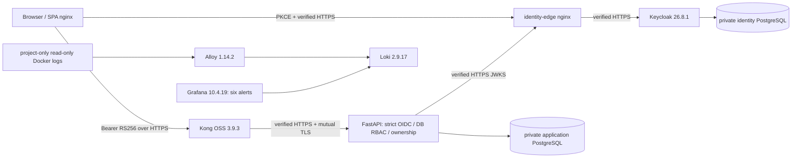

# Final container image security review — 2026-10-25

**Release readiness: BLOCKED.** Functional/security regression passes, but material HIGH/CRITICAL and lifecycle risks remain unaccepted. No production deployment, push, merge, history rewrite, secret commit or global Docker prune was performed.

## Scope and provenance

Starting branch: `migration/cloud-api-security`. Approved starting commit: `0b86cf04b471662f7731efac8f2cb34066752441`; branch, ancestry, working tree and remote accepted tip were checked. Existing untracked architecture/authentication/RBAC/security-requirement/threat-model documents, reports, slides and attack-scenario files were preserved.

The original inventory is the accepted disposable P7 runtime retained in the local image store. It is not a claim about unrelated production containers. Docker Desktop initially was stopped; starting it resumed the existing `nginx`, `backend` and `Duck-nettool` containers. They were inspected by name/resource inventory only and not reconfigured. All tests use independent random Compose projects, networks, secrets and volumes.

Validated runtime platform: **linux/amd64** on Windows/Docker Desktop with native WSL source snapshots. ARM64 manifests/wheels do not establish ARM64 runtime compatibility; no ARM64 support claim is made.

[Baseline inventory](final-image-evidence-20261025/baseline-inventory.json), [final inventory](final-image-evidence-20261025/final-inventory.json), [environment](final-image-evidence-20261025/final-environment.json) and [Windows/disk details](final-image-evidence-20261025/final-windows-environment.json) retain platform, OS, IDs/registry digests, entrypoint, image/configured user, ports, mounts, capabilities, rootfs, health checks and networks. Engine `.Id` and registry `RepoDigests`/descriptor are recorded separately. Custom builds have exact local content IDs but are not published registry artifacts.

## Exact eight-image comparison

| Component | Original exact Engine image ID | Final exact tested/scanned Engine image ID |
|---|---|---|
|backend|`sha256:a21afcf4d34be085a47f0c1da932589ecd2a1f61e1f2be9fa9cf279bc954fc0e`|`sha256:d612e8901241e9d46860ba06b37a05d48f29a0feb84bb51ca8ed1cf6b6b1b987`|
|kong|`sha256:8635e3c97b27cf71ed620bb30f6091dbab1d39aad99a6c54dd9c3cfccb6d1013`|`sha256:92035d16d7ff86b7bc12fb1d0090d29357d924238b1880f78735f3f2fea6b631`|
|keycloak|`sha256:4883630ef9db14031cde3e60700c9a9a8eaf1b5c24db1589d6a2d43de38ba2a9`|`sha256:a78d6b79572168cb25886b80a8b5b8d4ed4390743e3eecb810538683e209dd6b`|
|postgres|`sha256:ca0bd484cb98bf4b24eb1010e73fb3fcbd6714d240fbc1a10eea5b7dbecb641d`|`sha256:ca0bd484cb98bf4b24eb1010e73fb3fcbd6714d240fbc1a10eea5b7dbecb641d`|
|loki|`sha256:8b5bd7748d0e4da66cd741ac276e485517514af0bea32167e27c0e1a95bcf8aa`|`sha256:c4a25af6f2709fa625d88ee5df494a332a85f30e9575854031667823ecc5be04`|
|grafana|`sha256:7d5faae481a4c6f436c99e98af11534f7fd5e8d3e35213552dd1dd02bc393d2e`|`sha256:a9043254ba16fb10945cc27333963dfd08eccbb43b51f1222d831cc564e3a1f4`|
|alloy|`sha256:8f5666aebb871ba43ee2d65159c5d1c26c903720efafaf2d9ed4e237afc3bc88`|`sha256:eadfe35ea52b26cbec4d4d780fbcc31edb31108c1c9e537ca59557a5a102c712`|
|nginx|`sha256:47928bf67eb62a1863cb08d9ecb52d3e704304ba614eaee17884204677702951`|`sha256:1bc331a1680da03025334c86645bed67ff832f5e74985fb629afdc079a9e8510`|

The backend and nginx IDs are actual final Compose build artifacts. Bootstrap/migration/identity-bootstrap/JWKS-sync jobs use separately labelled backend builds; their exact IDs and identical RootFS layer lists are included in the inventory. Application and identity PostgreSQL use the same pinned image with independent volumes/networks/roles. The standalone production SPA test uses the exact identity-edge image ID, with separate assets/TLS/configuration mounts. [Additional executed images](final-image-evidence-20261025/final-additional-executed-images.json) and legacy/test scopes remain distinct.

## Changes and compatibility decisions

| Component | Applied decision | Verified boundary / retained limitation |
|---|---|---|
| Backend | Pin the already-used Python base digest; uninstall unused pip after hash-locked wheel installation and `pip check` | Python 3.11.17 and application dependency versions unchanged; runtime imports/clean migrations/bootstrap/full tests pass. Builder vendors still need review. |
| PostgreSQL | Pin application DB to the already-used 16 image digest, matching identity DB | Actual 16.15, same accepted bits and major; no data/schema rewrite or PG major migration. |
| nginx | Same 1.30.6 core, official alpine-slim digest plus exact wget/libidn2/libunistring packages | Removes unused libxml2/curl/Brotli surface. Raw slim failed the existing GNU-wget CA flag; the derived image passes real good-CA exit0 and bad-CA exit5. Three public paths use one exact artifact. |
| Loki | 2.9.8 → 2.9.17, all writer/reader/version-test pins together | Unchanged v11/boltdb/filesystem/168h config; old-data/new-write/cold rollback and physical expiry deletion pass. New OS advisories remain visible. |
| Grafana | 10.4.2 → 10.4.19 | Seeded SQLite/dashboard state upgrade, new writes and cold-copy rollback pass; provisioned dashboards/datasource/six real alerts pass. Still an old Go/component line. |
| Kong OSS | 3.8.0 → official 3.9.3 | Vendor nginx backports; DB-less schema, RS256/JWKS workflows and negative mTLS remain. New image default UID1001 cannot read owner-only UID1000 PKI; deployment explicitly preserves non-root UID/GID1000 and uses writable tmpfs prefix `/run/kong`, leaving packaged libraries intact. No key permission broadening. |
| Keycloak | 26.2.5 → 26.8.1 within major26 | Upstream supports the latest minor. Cold copied PostgreSQL migration152→237, keys/IDs/client/realm/application mappings, restart and rollback to original DB/image pass. Explicit JPA async-commit=false preserves prior durability; unused new `scim-api` disabled. JS adapter stays on its independently released 26.2.4. |
| Alloy | 1.14.1 → patch1.14.2 | Actual Go1.25.8/jsonparser1.1.2/gRPC1.79.3; unchanged project-only pipeline and confinement. Positions upgrade/restart/cold rollback uses real read counters, not Loki dedup alone. Many later advisories remain. |

The root issue in intermittent limiter fixtures was a single relative sleep failing to establish the next observed wall-clock bucket: one captured burst began at second59. The existing bounded P4 wait was shared with P5/P6. Request counts, expected401/429, forwarding-spoof checks, security headers and production limiter configuration were preserved. Initial failed status codes were not captured, so they are not retroactively asserted to have been429.

The fresh patch reviews found no runtime security bypass. A later independent Alloy-harness review found create-success/start-failure cleanup leakage; actual Docker exit127 reproduced it. Final cleanup checks project labels for container/volume/network names, handles absent resources and refuses foreign ownership. Both failure-path and full cold-positions drills were rerun. The standalone cleanup helper and P0 pip-free package inventory reader were edited after the mandatory-suite source snapshot and independently executed. The original P0 HTTP fixture then passed87 cases with its two inherited JWT xfails; runtime source/configuration and mandatory assertions were unchanged.

## Architecture after remediation

Network membership is reachability isolation, not encryption or a directional firewall. P1 standard API transport retains DNS/egress; app/identity data and observability boundaries remain internal. Neither Kong nor monitoring/identity containers join `app_data`. FastAPI runtime remains a DML-only DB role; privileged bootstrap and Alembic jobs remain separate. No frontend/backend plaintext bypass was introduced. The identity proxy’s HTTP readiness listener remains loopback-only inside its own container; it is not a FastAPI plaintext listener.

| Service | Network membership | Runtime/process observations |
|---|---|---|
|backend|api_transport, app_data, oidc_transport|writable root; cap_drop=None; privileged=False|
|db-bootstrap|app_data|writable root; cap_drop=None; privileged=False|
|migrate|app_data|writable root; cap_drop=None; privileged=False|
|identity-bootstrap|identity_data|writable root; cap_drop=None; privileged=False|
|kong-keys|oidc_transport|writable root; cap_drop=None; privileged=False|
|kong|api_transport, edge|writable root; cap_drop=None; privileged=False|
|keycloak|identity_data, identity_transport|writable root; cap_drop=None; privileged=False|
|postgres|app_data|writable root; cap_drop=None; privileged=False|
|identity-db|identity_data|writable root; cap_drop=None; privileged=False|
|loki|observability|writable root; cap_drop=None; privileged=False|
|grafana|observability|writable root; cap_drop=None; privileged=False|
|alloy|observability|RO root; cap_drop=['ALL']; privileged=False|
|identity-edge|identity_transport, oidc_transport|writable root; cap_drop=None; privileged=False|

The published local-development surface remains Kong8443 HTTPS, identity9443 HTTPS, SPA5174 HTTPS and Grafana3001 loopback management HTTP. PostgreSQL/backend/Loki/Alloy have no host port. Native Keycloak admin/management interfaces are not published and the identity proxy exposes only the reviewed realm/resources. Production PKI/remote Grafana TLS still require operator-managed procedures; lab PKI is not production PKI.

## Historical and reference configurations

- `docker/docker-compose.yml` alone retains the deliberate legacy local-JWT/base Promtail path. Active OIDC/Alloy validation uses the ordered P4/P5/P6 overlays; do not advertise the base file as the complete active production candidate.
- Base Promtail configuration can mount a broad Docker log root if used without a reviewed project-only manifest. Final Desktop legacy tests scope it to their own project; active P6 excludes Promtail. This historical path must not accidentally replace the scoped Alloy deployment.
- `tests/p0/compose.yml` is an independent historical HTTP/auth baseline, including its original privileged fixture DB. It is not an alternate production listener or P1 deployment recipe.
- `backend/nginx/default.conf` and `docs/deployment/compose-mtls.reference.yml` are already marked historical; the latter conflicts with current networks/roles and uses nginx instead of Kong. Neither is loaded by the tested deployment. They remain reference material rather than a second security architecture.
- P0–P7 reports and old image digests remain historical evidence. README/P7 dated follow-ups and current P2/P6 operational notes now point to this review, UID/prefix compatibility and current image pins.

## Connected scanning and risk interpretation

Docker Scout1.20.4 scanned all eight exact final image IDs on linux/amd64 with all severities, without ignore-base, severity filtering or suppression. The connected service returned complete reports; it does not expose a local advisory DB revision/update timestamp, so no precise DB-age assertion is made. Three initial parallel scans hit the shared-cache lock; sequential retries completed. Original failed receipts and successful retries are preserved.

| Image | Before C / H / M / L / unrated | After C / H / M / L / unrated |
|---|---|---|
|backend|2 / 7 / 4 / 27 / 0|1 / 2 / 2 / 26 / 0|
|kong|0 / 1 / 22 / 20 / 0|0 / 0 / 24 / 12 / 0|
|keycloak|6 / 66 / 104 / 25 / 0|1 / 11 / 14 / 6 / 0|
|postgres|4 / 33 / 30 / 55 / 1|4 / 33 / 30 / 55 / 1|
|loki|18 / 62 / 65 / 5 / 2|18 / 78 / 60 / 8 / 3|
|grafana|28 / 105 / 110 / 20 / 5|29 / 109 / 87 / 22 / 7|
|alloy|13 / 61 / 142 / 44 / 2|12 / 59 / 139 / 43 / 2|
|nginx|1 / 2 / 5 / 5 / 24|0 / 1 / 0 / 0 / 5|

Raw core HIGH/CRITICAL counts changed **409 → 358** (critical72→65, high337→293). These are package/version result records, not unique CVEs or proof of exploitability. Some components gain OS findings while fixing older Go/application issues. New findings and removed findings are retained, rather than suppressing base packages to improve the score.

[The 509-row risk register](final-image-risk-register.md) includes every canonical before/after image exposure, a separate legacy Promtail scan and CNA-HIGH findings hidden behind Scout’s unrated severity. All package variants/raw indices remain in [JSON](final-image-risk-register.json). There are98 scoped runtime remediations,68 evidenced platform/feature/callsite exclusions,1 verified Wget2 product mismatch,333 NEEDS INVESTIGATION,2 FIX REQUIRED and7 MITIGATED—RESIDUAL RISK rows. These totals include historical-only and legacy rows; they are not final unique CVE counts. Seven additional Kong nginx backports are vendor-verified separately.

Important scoped conclusions:

- PostgreSQL Go findings located only in `gosu` are not automatically PostgreSQL network flaws: official gosu1.19 source performs local UID/GID switching and exec, without the affected HTTP/TLS/XML APIs. PostgreSQL C-library findings remain open independently.
- Linux/amd64 excludes explicitly Windows-only Go and Darwin/BSD/Solaris host-ID paths; no multi-platform exclusion is claimed.
- Alloy has no Docker daemon/archive API/socket; fixed Alloy/Loki profiles do not enable affected SSH transports. These specific absent paths are evidenced, not inferred from private networks.
- Backend ECDSA timing and DER-to-HMAC JOSE issues retain strict algorithm/key-use counterevidence and unapproved residual risk. No broad library-wide safety claim is made.
- GNU Wget1.25.0 `-metalink` excludes the Wget2 report and the CNA-HIGH Metalink parser issue. Other unrated/medium wget and musl records remain visible.
- Keycloak OS sqlite/acl/attr/pcre/glibc/zlib presence alone does not prove a Java request path; the register leaves native-callsite/backport questions open.
- Kong’s compiled OpenSSL3.2.3 differs from OS OpenSSL3.0.13. [Upstream confirms 3.2 public EOL](https://openssl-library.org/post/2025-11-25-eol-32/). RPK feature exclusion closes only CVE-2024-12797, not the lifecycle risk.

## Hardening and build review

Actual PID1 checks show Kong1000, Keycloak1000, PostgreSQL999, Loki10001 and Grafana472. Backend and nginx master remain root. Alloy remains UID0 with read-only root, all capabilities dropped, no-new-privileges and only reviewed read-only project log mounts; no Docker socket/privileged container was found. Several services retain writable roots/default capability bounds and no memory/CPU limits. These are explicit hardening debts, not silently “fixed” by breaking TLS key access or collection.

The backend build context excludes env/secrets/keys/certificates. nginx’s new context permits only its Dockerfile. Secrets and leaf keys remain runtime mounts; offline signing keys are not mounted. P1’s built-layer/mount secret-canary checks and full negative TLS suite pass. Gitleaks plus byte/diff review found no real credential material in curated evidence; six generic-key matches are recomputed source SHA256 digests, retained and technically dispositioned without a scanner suppression. This is scoped evidence, not a universal absence proof.

Dependency inputs use pinned base/artifact digests, exact apk versions and Python/npm locks. The original runners still use mutable test-only PostgreSQL/Python helper tags in some paths; their actual image IDs are inventoried. Upstream apk indexes/package availability and BuildKit timestamps/labels are not fully frozen. Repeated builds may have different OCI IDs despite identical RootFS content. Do not claim bit-for-bit OCI reproducibility, signed provenance verification or offline rebuild certification.

The WSL frontend builder uses Node18.19/npm9.2, while Windows has Node24.14/npm11.9. [Node18 is EOL](https://nodejs.org/en/about/previous-releases), a build-tool lifecycle limitation rather than a Node process shipped in nginx. Do not infer builder security from passing browser behavior. Python advisory scan completed with five raw entries representing three unique advisories; npm completed with five moderate affected-package entries and no HIGH/CRITICAL. No automatic major dependency upgrade was performed. See the detailed testing report.

## Acceptance and next decisions

[Regression results](../testing/final-image-remediation-results.md) and [upgrade/rollback procedures](../deployment/final-image-upgrade-rollback.md) provide commands, counts, failed attempts, TLS evidence and storage drills. Functional gates pass for the final runtime artifacts. Material image/build/lifecycle risks remain open, and no authorized owner supplied a scoped, mitigated, accountable, dated exception. **Release remains BLOCKED.** Stop here; do not merge, push or deploy production.

Primary patch references: [Kong OSS3.9.3](https://github.com/Kong/kong/blob/3.9.3/CHANGELOG.md), [Keycloak26.8.1](https://www.keycloak.org/2026/10/keycloak-2681-released), [Keycloak release policy](https://github.com/keycloak/keycloak/blob/main/RELEASES.md), [Loki2.9 notes](https://grafana.com/docs/loki/latest/release-notes/v2-9/), [Grafana10.4.19](https://github.com/grafana/grafana/releases/tag/v10.4.19), [Alloy1.14.2](https://github.com/grafana/alloy/releases/tag/v1.14.2), [nginx slim Dockerfile](https://github.com/nginx/docker-nginx/blob/master/stable/alpine-slim/Dockerfile).
