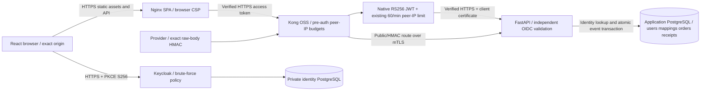

# P5 security hardening candidate

Acceptance is tracked in `../testing/p5-results.md`; this design is not a claim that validation has passed.



Application role, active status and ownership remain database decisions. Identity binding stays an explicit reviewed issuer/subject mapping. No business roles are assigned from token claims. No previous migration is replaced.

## Threat and access matrix

| Surface | Access | Control |
| --- | --- | --- |
| Product reads / health | Public | HTTPS, native and pre-auth limits |
| Webhook receive | Public bearer-independent | Exact raw-body HMAC, bounded timestamp/body, typed object, transaction receipts |
| Order reads/writes | Mapped active identity | Independent API JWT validation, database RBAC and ownership |
| Product mutations / SSRF validation | Staff/admin | Existing database role checks |
| User administration | Admin | Existing database policy and self-protection |
| Local login/register/refresh/logout | Retired in OIDC candidate | Existing P4 HTTP 410 |
| Signature helper / docs | Disabled production | No public gateway helper route; DEBUG=false |
| Keycloak admin / identity database | Private | Existing private networks and restricted identity edge |

## Webhook transaction and rotation

Canonical identity is `(configured provider, "id:" + external event_id)`. Never trust a provider name from a request. Legacy senders without an ID use `body-sha256:` plus a sorted JSON object digest. This preserves acknowledgements for old payloads, but cannot identify semantically identical events whose bodies differ. Providers should supply stable event IDs.

MAC verification uses the exact body bytes, canonical decimal timestamp, and strict lowercase `sha256=` hexadecimal encoding. Comparison is constant-time. A valid MAC is required even for receipt retries. JSON duplicate keys, non-finite values, non-object payloads and invalid known-event structures are rejected.

The composite database primary key arbitrates concurrent insertions. A winning insert, simulated handler and stored response commit in one transaction. Identical authenticated retries return the stored HTTP 200 acknowledgement and `X-Webhook-Replayed: true`; they do not invoke the handler again. Conflicting bodies for one explicit ID return 409. Handler failure rolls back both receipt and database effects, permitting a valid retry. There is no real settlement or fulfillment implementation. Future external effects require an outbox or equivalent reviewed delivery design; a SQL transaction cannot make arbitrary external operations atomic.

Migration `0003_webhook_receipts` adds provider, event_id, SHA-256, JSONB acknowledgement and received_at. Runtime gets SELECT/INSERT and UPDATE(response) only. It cannot delete receipts, rewrite identities/digests or run DDL. Retain receipts for at least the provider's replay/retry horizon; deleting them re-enables processing. No automatic retention job is introduced.

The optional `docker/webhook-rotation.compose.yml` mounts a previous runtime key. Explicit start/end timestamps must define at most 900 seconds. The old key is accepted only within that interval. Remove its mount after overlap. Do not commit either key. Current key rotation, provider namespace changes, or receipt deletion require operator review.

## SSRF policy

The staff/admin endpoint validates a URL and DNS results; it never fetches content. Allowed names must match the existing domain allowlist at a label boundary. Every DNS result must be valid global unicast. Mixed public/private answers fail closed. IPv4-mapped IPv6 is normalized before classification; loopback, private, link-local, metadata, unspecified, multicast, reserved and transition/tunnel forms are denied. Credentials, scoped addresses, invalid labels and parsing ambiguities are rejected. Deterministic DNS-mocked tests and real external DNS tests are separate acceptance evidence.

DNS validation alone does not prevent rebinding or time-of-check/time-of-use attacks. There is no subsequent fetch in this feature. Any future fetching functionality needs destination pinning, redirect checks and egress enforcement.

## Gateway and browser boundary

Only built-in Kong OSS serverless functions are added. Pre-function access budgets run before JWT; the unchanged native 60/min limiter runs after JWT. Pre-auth limits per transport peer are global 120/min, user routes 60/min, security routes 45/min, order mutations 60/min and webhook 90/min. Fixed-window boundaries permit boundary bursts. Counters are single-node local and reset on restart. OPTIONS is handled by exact-origin CORS. No forwarding header is trusted; deployments behind a proxy need independently reviewed proxy addresses before changing this policy. A shared frontend proxy aggregates browser users into one gateway peer budget.

Rejection logs include only status and route name. They do not log query values, bodies or bearer tokens. Kong API budgets do not protect Keycloak login. The P5 realm separately enables Keycloak brute-force protection (five failures, bounded waits); this policy needs its own live verification.

API responses use a restrictive no-content CSP. Browser HTML uses a separate exact-IdP CSP, self-hosted assets, no unsafe-inline/eval, and a development-only per-process nonce for Vite. The production Nginx SPA boundary verifies Kong's server certificate; Kong retains backend mTLS. HSTS is one year without preload or includeSubDomains; production operators must validate domain ownership and HTTPS readiness before rollout.

## Safe demonstrations

Security Center displays observed HTTP statuses, response snippets, headers, replay and limiter information. It does not claim percentages or monitoring counts. Missing/invalid token, current-role administration, SQL-shaped UUID validation and headers are read-only probes. Compile `VITE_SECURITY_LAB=true` only for an authorized disposable lab to expose fixture BOLA, webhook forgery/retry, metadata validation and bounded rate bursts. Supply another disposable customer's order ID. Generate HMAC deliveries using an operator-held disposable secret outside the browser; paste only the short-lived signature, timestamp and exact body. No signing secret or administrator credential belongs in the bundle. Client-certificate negatives run through P2 socket tests, not JavaScript. Monitoring links require an explicitly configured HTTPS Grafana URL; no metrics are invented.

## Migration and rollback

Use existing bootstrap/migration jobs with separate owner/runtime secrets, then start the P5 overlay after P4. Review exact frontend/issuer origins, runtime secrets and the generated SPA configuration. Existing users, external mappings and order/product foreign keys are untouched.

A code rollback must also align the Alembic version: unmodified P4 readiness expects `0002_external_identities` and will reject a database still stamped `0003_webhook_receipts`. Merely retaining the live table/version and starting P4 is not a working rollback.

Reviewed rollback procedure: stop ingress; take and verify a private full backup plus a receipt data export using privileged database tooling; retain these outside the checkout; run `alembic downgrade 0002_external_identities` with the P5 migration image/credentials; then deploy the P4 **OIDC** release and its original overlay. The downgrade drops only the live receipt table, so its replay history must remain in the verified backup. Existing users, mappings and order/product relationships remain. Validate P4 readiness, mTLS and authentication before restoring ingress. P4 reopens D03–D07; this needs explicit operational risk review and is not a security-equivalent fallback.

For a later P5 redeployment, stop ingress, upgrade to head, restore the retained receipt rows under the migration/administrative role before accepting new events, verify constraints and grants, then start P5. Events acknowledged during a P4 rollback were not recorded by the P5 receipt mechanism and cannot be reconstructed from that backup. A restore rehearsal is required before production use. No production rollback or data deletion was executed here. Do not manually stamp versions to hide unreviewed schema drift.

Compose remains a single-node candidate, not an HA production rollout. Public DNS availability, external egress controls, centralized distributed quotas and completed production authentication cutover remain operational limitations. P6/P7 are outside this change.

Offline lab signing example (the output contains a short-lived MAC and must remain private):

```sh
APP_ENV=test P0_ISOLATED=1 python3 tests/p5/lab.py --disposable-lab \
  --secret-file /path/to/disposable/webhook_secret --output /tmp/new-lab-delivery.json
```

Paste the file's body, timestamp and signature into the lab page, submit twice and inspect the actual identical acknowledgements and replay header. A new file is required on each CLI invocation; do not commit delivery files. This CLI does not issue network requests or implement payment effects.

Log limitation: the custom rejection message contains status and server route name only. Standard Kong/Nginx access/error logging may still include request URLs; clients must never put bearer tokens or secrets in query parameters, and production retention/access/redaction policies need operator review. No claim of comprehensive log scrubbing is made.

Receipt storage grows with valid unique events. Capacity monitoring, backups and a reviewed retention horizon are still operational requirements. Possession of the provider HMAC key permits signing arbitrary simulated events; this design does not establish independent business truth or protect against a compromised provider key.
