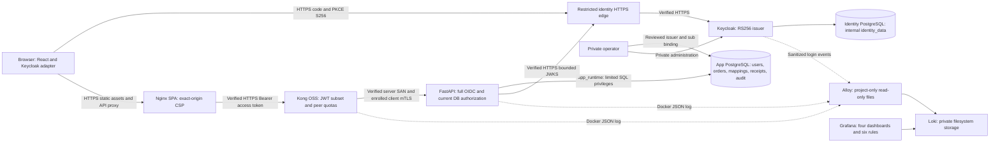

# P7 final security assessment

This is an academic SME API security **candidate**, single-node Docker Compose.
[The results and strict release matrix](../testing/p7-results.md) determine
acceptance; neither a commit nor the demonstration UI certifies a production system.
The user explicitly postponed real public DNS tests. They remain NOT EXECUTED
for this P7 run and keep strict acceptance BLOCKED.

## Architecture and trust boundaries

Exact memberships/absence of DB/admin ports are actual host assertions, not just
this diagram. The browser uses memory tokens and one-time state/nonce/verifier
transactions. PostgreSQL alone supplies application role, is_active and ownership.
Issuer+sub maps to existing UUIDs; email cannot auto-link. Kong OSS verifies the
configured signing-key/signature/time subset, not complete OIDC; FastAPI rejects
wrong issuer/audience/type independently. No local-token fallback is enabled.
Separate private databases, migration/runtime/audit grants and unchanged P2
CA/SAN/client enrollment remain required after recovery.

## Review of implemented controls

See [attack-to-control evidence](p7-attack-matrix.md). Positive integration uses
actual Keycloak code+PKCE tokens, negative signatures/claims are isolated attack
fixtures. PostgreSQL constraints enforce reviewed mapping uniqueness and durable
webhook identities. Typed request validation and ORM queries remain in use.
The SSRF endpoint validates only URL/DNS; it does not fetch remote content.
P5 normalized IPv4-mapped IPv6 and rejects mixed nonpublic answers; this is not a
claim of rebinding/redirect/TOCTOU-safe outbound fetching.

P6 allowlists structured fields; privacy canaries and real Alloy/Loki queries,
transactional audit rollback and restricted audit grants are tested. Loki labels
are service/project only; IDs stay fields. Keycloak raw Docker metadata can still
contain identity information even when the Loki projection drops it. Four upstream
TLS reasons are sanitized and explicitly unattributed; inbound handshake failures
are proven by TLS sockets, not claimed as per-user correlated application events.
No external notification delivery or immutable audit compliance is claimed.

## Dependency and deployment review

P7 records actual installed Python distributions, locked npm versions and image
IDs/provenance. Important inherited versions include FastAPI0.111.0,
python-jose3.3.0, python-multipart0.0.9, Keycloak26.2.5, Kong3.8,
Loki2.9.8 and Grafana10.4.2. These old pins need current version-aware advisory and
support review. They are **not** certified safe by behavioral test success.

No pip-audit, Trivy or Grype executable was available. The OSV HTTPS query failed
at the environment proxy with CONNECT403; the outside-sandbox retry was aborted
before a response. npm audit --offline exited0 with an empty vulnerability object,
but fetched no current advisory feed; this is NOT a clean current scan. No CVE,
severity or fixed version is invented from that empty response. Dependency/image
advisory gate remains BLOCKED until a supported connected scan and reachability
review completes. No infrastructure/dependency upgrade was made incidentally.

Source review confirms OIDC decode restricts RS256 and exact issuer/audience,
no token-directed key URL or JWE endpoint; legacy code is exercised separately.
That narrows some attack paths but cannot exclude library/OS CVEs. A future finding
must be classified by installed version, affected function, reachable route and
private/public placement before a minimal fix; unexplained relevant high/critical
findings block release. Obtain scanner version, feed timestamp, raw advisory IDs,
SBOM/image digest and exception rationale when completing this gate.

Actual container checks cover no privileged services, no Docker socket, private
DB/admin ports, narrow collector mounts and read-only TLS/key boundaries. File
secrets are host mounts, and a Docker/host administrator remains fully trusted.
Development CA keys never become production issuers. DEBUG remains false; browser
CSP/security headers are tested with the production build rather than assumed
from API headers. Network segmentation is not encryption of SQL traffic or a
unidirectional firewall. Some upstream image tags/dependency transitives remain
mutable; verified cloud image import is distinct from a new registry rebuild.

## Residual risks and release limits

- Deferred public DNS and incomplete live advisory/image scans block strict release.
- No HA, PITR, failover, encrypted off-host backup/RPO/RTO or production recovery drill.
- Lab paired recovery is distinct from cold Loki/Grafana/Alloy storage disaster restore.
- Logout does not instantly revoke issued access tokens (bounded300seconds); key
  retirement also has bounded cache behavior. Memory tokens remain exposed to XSS.
- Peer-IP quotas are local fixed-window counters; shared proxies aggregate users,
  counters reset on restart and there is no distributed quota guarantee.
- Webhook handler is a simulated acknowledgement, not real settlement; future external
  side effects need an outbox. Receipt deletion can reopen replay; no purge is added.
- DB owners can alter mappings/audit; compromised runtime can append false audit.
  Loki has no authentication on its private network; authorized peers can forge logs.
- Logs may be lost on rotation, disk full, long collector outage or stale mounts
  after container recreation; refresh mounts and validate fresh correlation.
- P6 physical retention was proven on two accelerated fresh-volume experiments;
  production two-hour delay, natural rollover and marker recovery are not newly certified.
- Legacy D01/D02 remain expected failures only in historical mode; P5 D03–D07 fixes
  remain required passes. Historical P0 reports are not rewritten.
- Concurrent inventory/order stock race resistance is NOT EXECUTED; webhook
  concurrency evidence does not certify inventory concurrency.
- No stable performance/MTTD/MTTR benchmark, public-CA deployment, MFA/BFF or privacy
  compliance certification. No production cutover, push or phase after P7 is performed.
