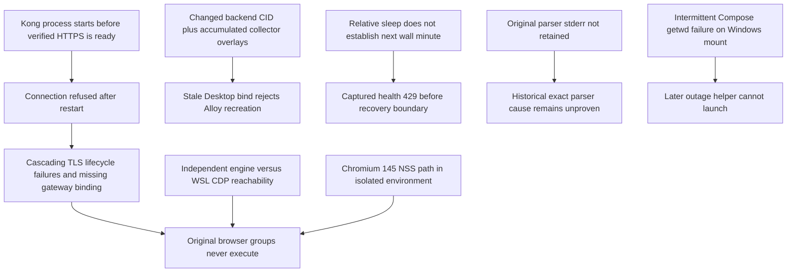

# Final acceptance remediation — FloraSecure P0–P7

**Functional regression: PASS. Release readiness: BLOCKED.** All mandatory
original legacy and active OIDC groups completed without unexpected failures,
unexpected passes or ordinary skips. Four historical legacy JWT expected-failure
executions remain. All three real-DNS IDs pass. Release is blocked by unresolved
material image/advisory risks without authorized risk acceptance. This is a local
remediation record, not a production deployment or approval.

Approved P7 `90117e623bfa2e18d701e1f283b2b617b9a50270` and subsequent DNS evidence
`9bd79a80c7b9ace1bd624a8a580a22354471345c` are preserved as ancestors. Branch:
`migration/cloud-api-security`. Harness commit:
`c46f81e7ec7ec779ae45662636c11f5448c2a343`. Dependency/nginx commit:
`e04357ece8f1be62573c412045357399cad1e170`.

## Evidence and boundaries

- [Complete per-case results, commands, DNS, runtime identities and hashes](final-remediation-evidence.json)
- [Before advisory assessment: all 1,091 supplied entries retained](final-remediation-advisory-triage.json)
- [After scans: all current image rules, package findings and proof gaps](final-remediation-advisories-after.json)
- [Desktop/WSL reproduction, security boundaries and rollback](../deployment/final-acceptance-local.md)
- [Original DNS recovery and failures](final-dns-acceptance-20261024.md)

Raw evidence, including unsuccessful runs, exact stderr, command receipts and
Docker inspect data, remains locally under ignored
`tests/p7/artifacts/final-remediation-20261024/`. Earlier DNS artifacts remain
under `tests/p7/artifacts/final-dns-20261024/`. Public exports omit full inspect/env,
private PKI, credentials, tokens, arbitrary logs and database exports. Public raw
receipt hashes identify the local sources without exposing their contents.

No existing application/container/volume was used for acceptance. The unrelated
`nginx`, `backend` and `Duck-nettool` containers remain running. No push, merge,
reset, global prune or history rewrite occurred. User untracked documentation,
reports, slides and attack scenarios were preserved. No transfer bundle is
needed: work was completed in the requested repository itself.

## Failure dependency graph



The browser had independent network/trust defects as well as downstream gateway
failures. No unsupported Kong schema change was inferred from missing stderr.

## Before/after issue matrix

| Issue | Observed reproduction and supported cause | Narrow change | Final evidence / limitation |
|---|---|---|---|
| P2 restart / expired client | Persistent-probe diagnostic returned connection refused while Kong was running/health starting and 8443 remained published. A slower fresh probe passed and restored configuration later returned 200. Process readiness precedes HTTPS listener readiness. | Bounded 45s verified edge HTTPS readiness; 502 accepted only as startup observation while a deliberately invalid upstream certificate is staged. | Both complete legacy and active runs: 16/16 methods. Original negative certificate/status assertions preserved. Not a claim that every historical cascade had the same cause. |
| P2 Vite method | First complete legacy retry reached 15/16; Vite request timed out. Separate cold-cache verified-CA control reached 200 in ~3.12s. | Retry connection/read timeout within fixed deadline. | Correct CA 200, wrong CA 500 and full method pass in both final runners. |
| TLS mount assertion | Desktop translated an intended WSL cert source into an opaque bind-mount ID after lifecycle operations. | Accept only exact Desktop translation shape, independently compare complete mounted names and SHA256 contents. | No offline issuer/peer keys, RO mounts and no published backend port assertions still pass. |
| P7 Alloy recreation | Deleted backend CID persisted in merged collector overlays; Desktop rejected stale source. Early adapter retries also exposed external-container syntax/mountpoint/duplicate-sequence issues. | Stable per-service targets; one collector overlay owner; opt-in project-only Desktop engine-path holder, refreshed on recreate. | Paired restore, backend recreation and real correlated backend log ingestion after recreate pass. No Docker API/socket or synthetic ingestion. |
| Rate recovery | Focused and full reruns captured final `/health` 429 at second58, `Retry-After: 2`; original historical response had not been captured. | Recheck next actual wall-clock minute after waking; monotonic deadline and allowlisted response/time evidence. | Final full OIDC 145/145; captured actual 429 then health200 at the next bucket. Native60/min/preauth policy and spoof protection unchanged. Exact VM clock-adjustment mechanism remains unproven. |
| Historical signing parser | Original command retained but stderr was absent. New native candidate parses successfully with unchanged Kong schema. | Persist sanitized parser/phase/outage stderr; reuse existing reviewed mapping fixture for focused rotation. | All six rotation phase entries pass, including retirement, actual JWKS outage, failed sync preserving config and recovery. Historical exact parser error remains unknown. |
| Compose outage launcher | Windows-mounted snapshots intermittently returned `getwd: no such file or directory` before Python; simple8+8 config checks did not reproduce it. | Use native WSL disposable snapshot, durable artifact copyback. | Full rotation/outage and both full drivers complete. Exact low-level NTFS/Compose cause remains unknown. |
| Browser CDP | Controlled original mode: engine-side Chrome145 CDP responds, WSL loopback refuses same port. | Opt-in Bubblewrap browser on WSL network plus project-only raw TCP IdP relay, preserving original TLS SNI/hostname and CA. | SDK9/9 and SPA8/8 original assertion groups pass. No TLS termination, ignoreHTTPSErrors or certificate bypass. |
| Browser NSS | First adapted runs reached browser but rejected CA. Chromium145 uses home fallback `/tmp/.pki/nssdb` in cleared child environment, rather than newer XDG convention. | Private namespace symlink to generated disposable NSS database; host HOME/personal trust unchanged. | Real CA/SAN verified; token refresh, nonce/state rejection, SSO/logout and unavailable IdP cases execute. Initial diagnostic crash133 was separate, not misclassified as original cause. |
| Legacy Promtail | WSL `/var/lib/docker/containers` bind resolved to empty Ubuntu storage. | Same opt-in project-only log adapter; native Linux default remains. | Original P1 host16/16 includes real Promtail readiness AND backend-event ingestion. Active collector stays Alloy. |
| Form parser | Bounded real-mTLS requests on old backend: ordinary form reaches410; oversized text/header/count/size also410, yielding1PASS/4FAIL. | Compatible reviewed parser/framework dependency updates; five new checks run separately from original suites. | Both final modes5/5: oversize400, ordinary legacy401/OIDC410 unchanged. This is not a load benchmark or a general file/body limit. |

## Final full regression matrix

Final candidate snapshot: `/tmp/florasecure-final-remediation-candidate-v9-20261024`.
Original unfiltered P3 and P7 drivers ran in unique disposable projects. Source
guards passed. No focus/filter/deferred DNS was set. Test-only Kong worker count
was2 to fit local resources; security policy and all assertions remain.

| Driver / group | Passed | Expected failures | Unexpected failures/errors | Ordinary skips / XPASS |
|---|---:|---:|---:|---:|
| Legacy `cloud-api-p3-080b311515b0`: P0/P1 pytest |106|2|0|0 / 0|
| Legacy: HTTPS pytest |85|2|0|0 / 0|
| Legacy: P3 identity pytest |22|0|0|0 / 0|
| Legacy: P1 host (DB/DDL/network/DNS/Promtail/image layers) |16|0|0|0 / 0|
| Legacy: P3 host |3|0|0|0 / 0|
| Legacy: P2 TLS/mTLS host methods |16|0|0|0 / 0|
| Legacy: new form-parser boundary methods |5|0|0|0 / 0|
| Active `cloud-api-p7-95cbd49eba9a`: P7 attack/security pytest |23|0|0|0 / 0|
| Active: P6 pytest |24|0|0|0 / 0|
| Active: P5 hardening pytest |110|0|0|0 / 0|
| Active: focused P4 control subset within full runner |3|0|0|0 / 0|
| Active: complete P4/inherited OIDC regression |145|0|0|0 / 0|
| Active: P4 / P3 host |5 / 3|0|0|0 / 0|
| Active: P2 TLS/mTLS host methods |16|0|0|0 / 0|
| Active: new form-parser boundary methods |5|0|0|0 / 0|
| Active: original SDK / production SPA browser groups |9 / 8|0|0|0 / 0|
| Original session unit script (additional control) |PASS|0|0|0 / 0|
| Active: rotation/retirement/outage phase entries |6|0|0|0 / 0|
| Active: paired DB recovery, backend recreate and recovered monitoring |PASS|—|0|0 / 0|
| Active: P6 initial/recovered/outage telemetry and six real alert transitions |PASS|—|0|0 / 0|

Legacy ran12:07:16–12:18:04UTC; active12:02:37–12:31:34UTC on2026-10-24.
Both driver exits and cleanup exits0. JUnit represents expected failures using
`skipped type=pytest.xfail`; those four executions are not ordinary skipped tests.
They are D01 missingexp and D02 malformedsubject, each HTTP+HTTPS. Earlier P5
fixes already replaced the other five P0 defects in approved history; this task
did not silently reclassify seven baseline defects. Counts are per group;
repeated executions, distinct cases and unittest subtests are not summed.
The original session unit script also exited0 on the final source. Its SDK stub
is the original unit fixture; real browser and DNS acceptance are independent.

All original 16 TLS methods retain their security assertions: valid communication;
missing/untrusted/expired/unsuitable/unenrolled client; server hostname/trust;
plaintext rejection; rotation/recovery; key/log/mount protections; verified Vite
proxy. Handshake failures are distinguished from HTTP401/403. TLS method names
and outcomes are exported, not inferred from business-test success.

## DNS acceptance

| Exact original ID | Final result |
|---|---|
| `test_public_dns_for_current_ssrf_validation` |PASS, original P1 host method|
| `test_https_ssrf_uses_real_dns_and_preserves_roles[staff-200]` |PASS, original HTTPS regression|
| `test_https_ssrf_uses_real_dns_and_preserves_roles[admin-200]` |PASS, original HTTPS regression|

Real host resolution of example.com and pypi.org, disposable bridge-container
resolution and resolution inside the actual legacy backend and its network
namespace all returned exit0. Actual backend resolver127.0.0.11 forwards to
Desktop host resolver192.168.65.7; no overrides were configured. Host resolver
inventory includes Ethernet8.8.8.8 and WARP127.0.2.2/127.0.2.3. Recorded addresses
are outputs, never hosts-file substitutions. Full active SSRF tests pass too.
Staff/admin use original fixture authentication, real verified HTTPS/mTLS and
`https://example.com/test` returning200. The endpoint validates URL/DNS only;
it does not fetch remote content. No SSRF validator code changed.

## Dependency and image review

Harness reliability and complete original before-update regressions were
established before dependency updates. A prepatch investigator and independent
postpatch reviewer assessed the immutable candidate. Reported compatibility
issue (AMD64-only lock) was repaired by adding ARM64 hashes for identical pins;
the separate filename/file-size limitation is retained below. No unrelated
business or authentication redesign was introduced.

| Component | Before → after | Verification and remaining decision |
|---|---|---|
| FastAPI / Starlette |0.111.0 / old transitive →0.135.0 /1.3.1|Real form boundary tests plus full business/auth regression; Pydantic2.7.1 preserved.|
| python-multipart |0.0.9 →0.0.31|Text/header/field limits verified; file-size caveat below.|
| python-jose |3.3.0 →3.5.0|RS256/OIDC and HS256 historical regression pass; DER/HMAC advisory remains mitigated by explicit algorithm/key-type restrictions, not version-clean.|
| cryptography |46.0.5 →50.0.2|PKI tooling and actual all16 TLS methods pass; installed wheel OpenSSL4.0.3 differs from Python ssl OpenSSL3.5.7.|
| python-dotenv |1.0.1 →1.2.2|Existing settings/startup tested; no application write-helper use.|
| Packaging |pip26.2 / setuptools84.1.0 / wheel0.46.3|Resolved/pinned/hash-checked; pip's own vendored findings are separately retained.|
| Axios / Vite / PostCSS |1.18.1 /6.4.3 /8.5.15 →1.20.0 /6.4.5 /8.5.31|Lockfile updated with compatible transitives; original real SDK/SPA groups pass.|
| nginx |1.27-alpine →1.30.6-alpine, pinned digest|Three image pins updated consistently. Explicit old proxy defaults retained; actual legacy/base, P6 identity and generated SPA configs operate. Stateless; no storage migration.|

Docker installs51 exact hashed CPython3.11 distributions. All current AMD64
package versions and wheel hashes match the fully tested snapshot. Final lock
adds ARM64 wheel hashes plus canonical input-digest comments; generator is not
runtime code. All51 final AMD64 wheels were installed offline in a read-only,
network-disabled container with a task-owned writable target onD:, and pipcheck
passed. The final comment-only normalization was separately regenerated on
Windows/Linux identically and hash-download verified. ARM64 wheels were actually
resolved/downloaded with hashes, but ARM64 runtime tests were not executed.
Full regressions were not repeated for this manifest-only equivalence step.

Connected pip-audit of **actual installed runtime pins** reports5 raw records
across3packages (3 distinct package/ID pairs), down from66 raw/35 exact package-ID
records in the original scan. Duplicate ECDSA/pytest records and aliases remain
visible. ECDSA Minerva signing/keygen/ECDH is unused; pytest finding requires a
local competing user and is isolated to tests; python-jose DER/HMAC requires
unrestricted algorithms, whereas both supported paths restrict algorithms and
OIDC requires RSA. These are scoped counterevidence, not global library safety.

npm audit completed:13(7HIGH/6MODERATE) →5(0HIGH/5MODERATE); production4(2HIGH/2MODERATE)
→2(0HIGH/2MODERATE). Residual Router SSR/hydration/redirect APIs are absent in
the SPA; selector parsing is trusted CSS build input. Router7/Tailwind4 forced
major migrations were not applied. Raw moderate findings remain in the ledger.

All eight **actual runtime image IDs/digests and linux/amd64 platform** were
reinspected and scanned with Scout1.20.4. Image IDs, registry RepoDigests and
configured references are recorded separately. These are rule entries, not unique
exploits; aliases and package paths can repeat.

| Image | Before C/H/M | After C/H/M | Decision |
|---|---|---|---|
| Backend |2/14/17|2/7/4|Parser fixes verified; remaining OS/vendor/tool/library findings retained.|
| Kong |0/1/22|0/1/22|Configured TLS is not DTLS; bundled OpenResty/OpenSSL coverage still requires investigation.|
| Keycloak |6/63/98|6/63/98|Material unresolved findings; supported provider/session/storage upgrade not established.|
| PostgreSQL |4/33/30|4/33/30|Many Go entries target gosu, not SQL server; exact caller evidence retained, other gaps remain.|
| Loki |16/55/63|16/55/63|Upgrade/storage compatibility unresolved; no blind v11 boltdb→major migration.|
| Grafana |26/96/108|26/96/108|Authentication does not repair vulnerable dependencies; supported upgrade unresolved.|
| Alloy |11/54/130|11/54/130|Docker-daemon handlers absent/no socket; remaining Go/integration findings unresolved.|
| nginx |16/61/64|1/2/5|Core image patched; bundled libxml2/curl/brotli findings still require vendor/caller verification.|

Before990 → after837 image rule entries; HIGH/CRITICAL458 →377. No finding was
hidden using `ignore-base`, severity downgrades or scanner exceptions. Pip's
top-level package inventory does not include its bundled certifi2026.6.17,
msgpack1.1.2, setuptools70.3.0 or urllib3.2.7.0; Scout locates these under
`pip/_vendor/bom.cdx.json`. Updating the top-level packages does not close those
bundled findings. Their affected install-time callers/fixed pip release remain
unproven and are recorded as supply-chain review gaps.

Scout exit0 means completed scan, never clean. Pip/npm exit1 means findings in
successful connected audits, not unavailable advisory service. One Scout cleanup
warning about a locked temporary archive onD: did not prevent the SARIF export;
it is preserved. No global cleanup was used to conceal findings.

The before ledger retains every supplied HIGH/CRITICAL and relevant moderate
entry, ranges, installed versions, claimed fixes, scope, decision, evidence and
proof gaps. The after ledger retains all837 current image entries and all current
Python/npm findings. Many exact infrastructure exploit paths and safe upgrade
plans remain **NEEDS INVESTIGATION**. No authorized reviewer has accepted these
material risks. Accordingly this is partial advisory remediation, not completed
vulnerability closure or final release acceptance.

## Remaining limitations and release gates

| Gate | Status | Reason |
|---|---|---|
| RealDNS, original security regression, all16TLS methods |PASS|Actual complete runs, no required regression skipped.|
| Browser/rotation/recovery/real collectors/alerts |PASS|Original groups and real ingestion/engine evaluations complete.|
| Architecture/business preservation |PASS|No application policy/schema/JWT/OIDC/network/trust change.|
| Dependency/advisory scan execution |PASS|Actual runtime pins/npm plus all eight images scanned.|
| Material vulnerability disposition |BLOCKED|Unresolved infrastructure/vendor findings and incomplete exact reachability/compatible-upgrade assessment; no risk acceptance.|
| Secret/diff review |PASS|Targeted staged-byte pattern checks plus manual diff review; see commit evidence. Not proof against every possible secret type.|

Additional limits: local single-node AMD64 lab, no load/HA/production certificate
certification; no ARM64 runtime claim. Alert rules were evaluated by the real
Grafana engine; external notification delivery was not tested. File parts with a filename are spooled as
UploadFile and not covered by the text max_part_size check. Independent review
reproduced this distinction with2MiB file data; this is a pre-existing separate
file/total-request budget limitation, not evidence that the tested text/header
fixes failed. Active retired-auth routes reject at Kong; direct backend requires
enrolled mTLS. Do not advertise universal upload/body DoS protection. No new
business middleware/policy was added to close that separate gap silently.

Historical parser stderr and the low-level intermittent NTFS getwd/VM clock
mechanisms remain unproven. The report distinguishes these from reproducible
harness causes and actual successful native runs. No claim of full root-cause
certainty or vulnerability-free images follows from functional PASS.

## Commands, changes and rollback

Public evidence includes exact top-level invocation arrays and all596 active
runner commands plus the legacy runner command inventory, scan commands and
receipt hashes. Environment-only options are documented in the deployment guide.
Representative executed commands:

```text
git -c safe.directory=D:/MatMaHoc/Project_CLOUD_API status --short
git -c safe.directory=D:/MatMaHoc/Project_CLOUD_API branch --show-current
git -c safe.directory=D:/MatMaHoc/Project_CLOUD_API rev-parse HEAD
git -c safe.directory=D:/MatMaHoc/Project_CLOUD_API log -8 --oneline
git -c safe.directory=D:/MatMaHoc/Project_CLOUD_API merge-base 90117e623bfa2e18d701e1f283b2b617b9a50270 HEAD
docker version
docker compose version
wsl --list --verbose
Resolve-DnsName example.com
Resolve-DnsName pypi.org
python tests/p3/run.py
python tests/p7/run.py
python docker/lock_requirements.py --report <recorded-amd64-report> --arm64-report <recorded-arm64-report>
python -m pip_audit --disable-pip --no-deps -r <actual-runtime-pins> --format json
npm.cmd audit --prefix frontend --json
npm.cmd audit --prefix frontend --omit=dev --json
docker scout cves --format sarif --platform linux/amd64 --only-severity critical,high,medium local://<actual-image-id>
git -c safe.directory=D:/MatMaHoc/Project_CLOUD_API diff --cached --check
```

The displayed driver commands are the original scripts executed inside the
recorded native snapshot by the local recorder; full actual wrapper/environment
and scanner output-path arguments are in JSON, not substituted command claims.

Rollback is local and scope-specific: revert the relevant reviewed commit in a
new commit, restore manifests/lock/image pins together, rebuild only isolated
project services and rerun the applicable TLS/OIDC/business/ingestion checks.
nginx is stateless and schema is unchanged; do not roll back unrelated database
volumes or keys. Reverting dependency fixes reopens parser/advisory exposure.
Never use test credentials, private PKI or these disposable volumes in production.

## Earlier unsuccessful/intermediate executions (retained)

These are historical attempts, not overwritten PASS records. The final two
candidate runs above are the acceptance regression results.


| Run/group | PASS | xfail | FAIL/error / execution gap |
|---|---:|---:|---|
| Initial single expired-client diagnostic, slow fresh probe |1|0|0; does not reproduce fast-probe timing|
| Same original method with persistent probe |0|0|1; connection refused|
| First full TLS retry after HTTPS wait |15|0|1 Vite environment failure (Windows node_modules on Linux)|
| Legacy `cloud-api-p3-f7ffe099270d`: P0/P1 pytest |106|2|0|
| Same legacy: HTTPS pytest |85|2|0|
| Same legacy: identity pytest |22|0|0|
| Same legacy: P1 host |16|0|0, real Promtail ingestion and DNS|
| Same legacy: P3 host |3|0|0|
| Same legacy: P2 host methods |15|0|1 error: Vite request timeout|
| P7 `cloud-api-p7-1a023870b876`: scenarios |23|0|0|
| Same P7: paired DB restore/recreate/return |PASS|—|0|
| Same P7: recovered monitoring |PASS|—|0; new backend correlation ingested|
| Same P7: P6 pytest |24|0|0; six engine alert transitions and lifecycle evidence|
| Same P7: P5 pytest |110|0|0|
| Same P7: focused P4 subset |1|0|2: premature window recovery and following health assertion|
| Same P7: full P4/OIDC/P2/P1 pytest |144|0|1: premature window recovery|
| Same P7: P4/P3 host |5 / 3|0|0|
| Same P7: TLS/browser/rotation |—|—|INTERRUPTED before final results|
| New parser boundary control on old P7 backend |1|0|4 missing parser limits; expected before remediation, not historical xfails|
| P7 `cloud-api-p7-c4808c8933a2`: P7/P6/P5 pytest |23 / 24 / 110|0|0|
| Same P7: focused/full P4 |3 / 145|0|0|
| Same P7: P4/P3 host |5 / 3|0|0|
| Same P7: P2 TLS methods |15|0|1 Desktop source-path representation assertion|
| Same P7: browser helpers |0|0|CDP startup blocked; assertion groups unexecuted|
| Same P7: rotation |4 phases|0|outage startup: Compose getwd error|
| Native WSL focused SDK `cloud-api-p4-0281ddae5db6` |9 groups|0|0; runner and cleanup exit 0|
| Native WSL focused rotation `cloud-api-p4-8e0505c5fc4f` |6 phase entries|0|0; includes repeated verify-retired after recovery; runner/cleanup 0|
| Native legacy `cloud-api-p3-65f80101acc5`: P0/P1 pytest |106|2|0|
| Same legacy: P3 pytest/host |22 / 3|0|0|
| Same legacy: P1 host |16|0|0; DNS, Promtail, namespaces, DDL and image-layer audit|
| Same legacy: HTTPS pytest |85|2|0; total four legacy expected-failure executions retained|
| Native full active `cloud-api-p7-0553ce771937`: P7 |23|0|0|
| Same active: recovery and real monitoring |PASS|—|0; final completion recorded below|
| Same active: P6 pytest |24|0|0; 311.74 seconds|


Docker Desktop/Ubuntu restarted between continued turns, interrupting an earlier
P7 process without final run/TLS/browser results; stopped test containers showed
exit255. Its explicitly labeled project was cleaned, not unrelated resources.
An early attempt before restoring tooling failed during setup. Initial offline
lock-install attempt lacked a writable temp directory under read-only root;
the corrected rerun used an owned D: directory and succeeded. All such evidence
is retained; these attempts are not reclassified as executed passing tests.

Windows system-drive free space fell from~6.7GiB to below350MiB; Docker still has
20CPUs/~7.61GiB. Scanner cache/temp and image-secret archives were directed toD:.
No global prune/unrelated deletion was used. Production capacity is not certified.
The approval service once declined metadata review due its usage limit; later
ordinary review succeeded. No safety rejection was bypassed.

## Exact changed files and Git review

### Harness/platform: 20 files, 543 insertions / 80 deletions

```text
docker/render_collector.py
docs/deployment/final-acceptance-local.md
tests/browser_runtime.py
tests/p1/host_checks.py
tests/p2/host_checks.py
tests/p3/Dockerfile.dockerignore
tests/p3/run.py
tests/p4/Dockerfile.dockerignore
tests/p4/browser.mjs
tests/p4/browser_host.py
tests/p4/rotation.py
tests/p4/rotation_host.py
tests/p4/run.py
tests/p4/test_cutover.py
tests/p5/Dockerfile.dockerignore
tests/p5/browser_host.py
tests/p5/run.py
tests/p6/run.py
tests/p7/run.py
tests/project_logs.py
```

### Runtime/dependency plus added boundary verification: 23 files, 310 insertions / 88 deletions

```text
backend/Dockerfile
backend/build-requirements.txt
backend/requirements.lock
backend/requirements.txt
docker/docker-compose.yml
docker/keycloak/nginx.conf
docker/keycloak/p6-nginx.conf
docker/lock_requirements.py
docker/p5-compose.yml
docker/pki-requirements.txt
docker/render_spa.py
frontend/package-lock.json
frontend/package.json
tests/p0/Dockerfile
tests/p1/Dockerfile
tests/p2/Dockerfile
tests/p3/Dockerfile
tests/p3/run.py
tests/p4/Dockerfile
tests/p5/Dockerfile
tests/p5/browser_host.py
tests/p7/parser_checks.py
tests/p7/run.py
```

Documentation/evidence commit additionally updates README, this report,
P7 follow-up, the local deployment guide and the three public JSON evidence/
advisory files. Historical reports remain unchanged beneath dated follow-ups.
Harness staged review20files/0findings; dependency staged review23files/0findings;
documentation staged review7files/0findings, with staged diff checks passing.
The final diff summary and exact documentation
commit SHA are reported with completion, avoiding a self-referential commit hash.
The tracked working tree must be clean after that commit; preserved user
untracked files do not mean a failed cleanup.
